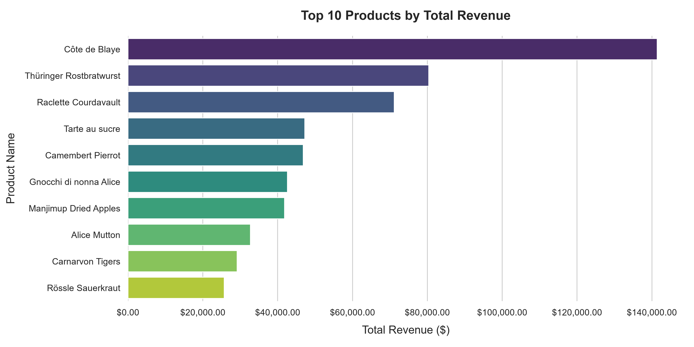

# Northwind Analytics: Automated BI & Corporate Risk Pipeline

> **Summary:** SQL + Python pipeline that loads the Northwind sample database into PostgreSQL, segments customers with RFM scoring, and flags revenue-concentration and shipping-delay risks.
>
> **Tech stack:** Python, PostgreSQL (SQL window functions & CTEs), pandas, SQLAlchemy, matplotlib, seaborn



An end-to-end, engineering-first data pipeline that transforms relational database schemas into production-grade business intelligence assets. This system automates quantitative RFM customer segmentation, detects supply chain bottlenecks, and calculates market concentration risks using corporate portfolio models.

## Key findings

From [`outputs/executive_risk_summary.md`](outputs/executive_risk_summary.md):

* **Revenue is well diversified:** customer HHI is 457 and product HHI is 327, both far below the 1,500 "structural dependency" threshold.
* **Two accounts each exceed 10% of revenue:** QUICK-Stop (10.54%) and Ernst Handel (10.02%).
* **One product exceeds 10% of revenue:** Côte de Blaye (11.17%).
* **Ireland is the only shipping corridor over the 15% late-delivery threshold:** 15.79% (3 of 19 shipments).

## How to run

1. **Data source:** the four Northwind tables (`customers`, `products`, `orders`, `order_details`) are downloaded by `scripts/load_northwind.py` from the public [neo4j-contrib/northwind-neo4j](https://github.com/neo4j-contrib/northwind-neo4j/tree/master/data) CSVs. You need an empty PostgreSQL database (the scripts were written against [Neon](https://neon.tech)).
2. **Install:**
   ```bash
   python -m venv .venv && source .venv/bin/activate   # Windows: .venv\Scripts\activate
   pip install -r requirements.txt
   ```
3. **Configure:** copy `.env.example` to `.env` and set `NEON_DATABASE_URL` to your PostgreSQL connection string. `.env` is git-ignored; never commit it.
4. **Load the data:** `python scripts/load_northwind.py`
5. **Generate the report** (run from the repo root, since outputs go to `./outputs`): `python scripts/generate_report.py`

Charts, CSVs and the markdown reports are written to `outputs/`.

---

## 🚀 Key Features

* **Database Lifecycle Management:** `scripts/load_northwind.py` downloads the four Northwind CSVs and loads them as tables (`customers`, `products`, `orders`, `order_details`) into PostgreSQL.
* **Quantitative RFM Segmentation Engine:** Extracts raw customer order frequencies, spending patterns, and recency timelines using advanced SQL window functions (`NTILE(5)`), mapping accounts into actionable business segments.
* **Advanced Visualization Suite:**
  * *RFM Scatter Map:* Features a custom inverted X-axis (most recent buyers on the right) and log-scaled monetary Y-axis to clearly reveal account distributions without "whale account" scale compression. Includes pixel-offset pointer annotations to prevent text overlap.
  * *Behavioral Heatmap:* Quantifies core operational metrics (averages across spend, count, and recency) for seamless executive assessment.
* **Automated Corporate Risk Assessment Module:** Calculates the Herfindahl-Hirschman Index (HHI) for both revenue streams and product catalogs to instantly flag portfolio vulnerabilities, "Whale account" exposures (inflows crossing >10%), and international shipping corridor latency hotspots.

---

## 📁 Repository Architecture

```text
northwind-sql-analysis/
│
├── .env.example              # Template configuration for database credentials
├── .gitignore                # Blocks .env and local artifacts
├── README.md                 # Project overview and run instructions
├── requirements.txt          # Python package dependencies
│
├── notebooks/                # Exploratory research & prototype code
│   └── 01_exploration.ipynb  # Initial database exploration and insight mapping
│
├── scripts/                  # Executable pipeline modules
│   ├── load_northwind.py     # Downloads Northwind CSVs and loads them into PostgreSQL
│   └── generate_report.py    # Reporting pipeline (RFM, charts, risk summary)
│
└── outputs/                  # Generated charts, CSVs and markdown reports
```
